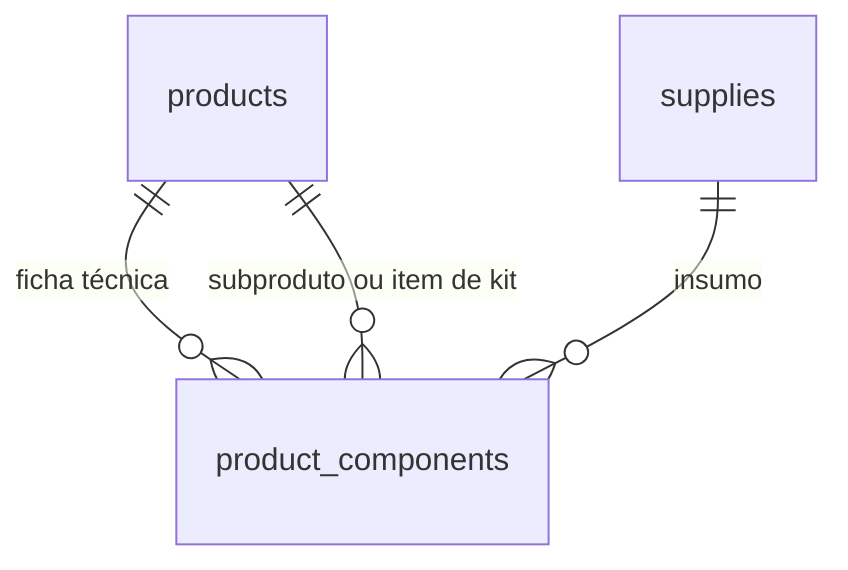

# Spec 060 — Produtos e composições (Etapa 5.3)

**Status:** Implementada — migrations aplicadas ao Supabase
**Fonte de verdade:** `task.md`, seções "Produtos" e "Etapa 5 — Cadastros"

## Objetivo

Manter o catálogo interno de produtos e suas fichas técnicas para uso nas etapas
posteriores. Esta etapa não calcula custo total nem preço de venda.

## Modalidades

- **Fabricado:** pode combinar insumos e produtos/componentes reutilizáveis.
- **Revenda:** pode referenciar insumos cadastrados como mercadorias adquiridas.
- **Impressão 3D:** pode referenciar insumos e registrar minutos de mão de obra.
- **Kit:** deve ser composto por um ou mais produtos cadastrados.

O tempo de mão de obra é opcional, expresso em minutos por unidade e limitado a
48 horas. Custos de energia, máquina, acabamento e taxa de falha são informados
diretamente na ficha do produto (ver `products`). Taxas e preços pertencem ao
motor de precificação (Etapa 6).

## Modelo de dados

Implementação em `20261102120000_create_products.sql` e
`20261102130000_product_composition_integrity.sql`.

### `products`

- UUID, nome único sem distinção entre maiúsculas/minúsculas, modalidade,
  minutos de mão de obra opcionais, observações, situação e timestamps.
- Custos auxiliares opcionais de impressão 3D (migration
  `20261103072000_add_printing_costs_to_products.sql`):
  - `energy_cost_cents` — energia por unidade;
  - `machine_cost_cents` — depreciação da máquina por unidade;
  - `finishing_cost_cents` — acabamento por unidade;
  - `failure_rate_percent` — percentual de perda 0–100, usado para ampliar o
    custo de material (`material × (1 + taxa)`).
  Todos opcionais: **entram no custo apenas quando informados**.
- Desativação lógica por `is_active`; exclusão física (lixeira) disponível ao
  administrador. A exclusão é **em cascata**: remove a ficha técnica própria, o
  custo registrado (`cost_snapshots`), as simulações de precificação e a
  composição em kits que usam o produto. Migrations
  `20261111090000_allow_admin_delete_domain_rows.sql` (permissão de DELETE) e
  `20261113100000_allow_cascade_delete_domain_dependencies.sql` (cascata).
- A confirmação da lixeira lista o que será removido junto (custos registrados,
  simulações e kits). Quem precisa preservar o histórico deve usar a
  **desativação lógica** em vez da exclusão.

### `product_components`

- UUID e produto dono da ficha técnica.
- Cada linha aponta para **um** insumo ou **um** produto, nunca ambos.
- Quantidade positiva com até três casas decimais.
- Uma composição pode reutilizar subprodutos; kits só aceitam referências a
  produtos.
- A aplicação e o banco impedem ciclos diretos ou indiretos. A gravação da
  ficha completa é transacional.

## Acesso e histórico

- Usuários autenticados podem consultar o catálogo, sujeito a RLS.
- Escrita de produtos e composições é exclusiva de administradores, validada
  nas Server Actions e novamente pelo banco/RLS.
- Alterações são registradas em `configuration_history`.
- Exclusão lógica e exclusão física (lixeira) de produtos; composições são
  substituídas na transação de gravação. O DELETE físico de produto cascata a
  ficha técnica própria, mas é bloqueado por RESTRICT quando há histórico ou
  referência de kit.
- Conversões de unidade foram implementadas na subetapa 5.4 (ver spec 040);
  a integração ao cálculo de custo ocorre na Etapa 6.

## Interface

- Rota `/produtos`, restrita ao administrador no servidor e no menu.
- Lista produtos ativos e inativos, modalidade, composição e situação.
- Permite criar, editar, ativar/desativar e excluir produtos.
- Formulário compõe cada linha com um insumo ou produto existente e quantidade.
- Não exibe preço nem apresenta cálculo financeiro como resultado desta etapa.

## Validações

- Nome entre 2 e 120 caracteres; observação até 500.
- Minutos de mão de obra inteiros de 0 a 2880 quando informados.
- Cada componente tem identificador válido e quantidade positiva, até três
  casas e no máximo 1.000.000 por linha.
- Kit precisa de pelo menos um componente do tipo produto.
- Produto não pode conter a si próprio, direta ou indiretamente.
