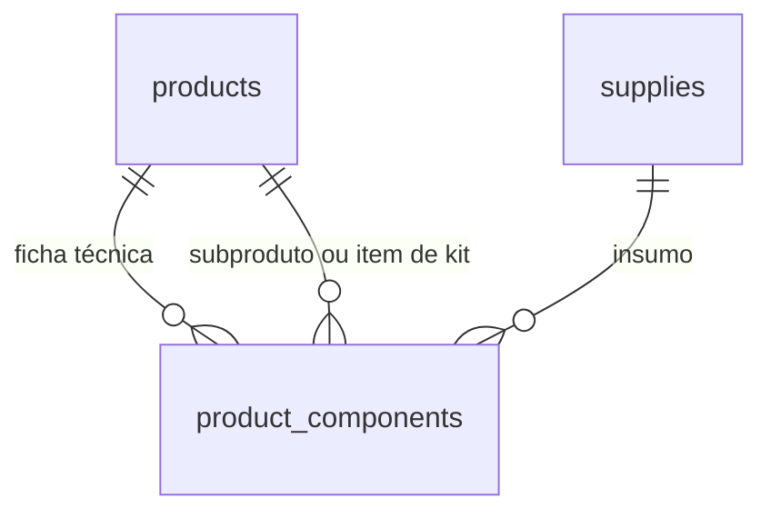

# Spec 060 — Produtos e composições (Etapa 5.3)

**Status:** Implementada no código; migrations pendentes de aplicação no Supabase
**Fonte de verdade:** `task.md`, seções "Produtos" e "Etapa 5 — Cadastros"

## Objetivo

Manter o catálogo interno de produtos e suas fichas técnicas para uso nas etapas
posteriores. Esta etapa não calcula custo total nem preço de venda.

## Modalidades

- **Fabricado:** pode combinar insumos e produtos/componentes reutilizáveis.
- **Revenda:** pode referenciar insumos cadastrados como mercadorias adquiridas.
- **Impressão 3D:** pode referenciar insumos e registrar minutos de mão de obra.
- **Kit:** deve ser composto por um ou mais produtos cadastrados.

O tempo de mão de obra é opcional, expresso em minutos por unidade e limitado a
48 horas. Custos de máquina, perdas, energia, taxas e preços pertencem às etapas
de precificação e operação.

## Modelo de dados

Implementação em `20261102120000_create_products.sql` e
`20261102130000_product_composition_integrity.sql`.

### `products`

- UUID, nome único sem distinção entre maiúsculas/minúsculas, modalidade,
  minutos de mão de obra opcionais, observações, situação e timestamps.
- Desativação lógica por `is_active`; não há exclusão física pela aplicação.

### `product_components`

- UUID e produto dono da ficha técnica.
- Cada linha aponta para **um** insumo ou **um** produto, nunca ambos.
- Quantidade positiva com até três casas decimais.
- Uma composição pode reutilizar subprodutos; kits só aceitam referências a
  produtos.
- A aplicação e o banco impedem ciclos diretos ou indiretos. A gravação da
  ficha completa é transacional.

## Acesso e histórico

- Usuários autenticados podem consultar o catálogo, sujeito a RLS.
- Escrita de produtos e composições é exclusiva de administradores, validada
  nas Server Actions e novamente pelo banco/RLS.
- Alterações são registradas em `configuration_history`.
- Sem hard delete de produtos; composições são substituídas na transação de
  gravação e não representam histórico financeiro.
- Conversões de unidade permanecem na subetapa 5.4.

## Interface

- Rota `/produtos`, restrita ao administrador no servidor e no menu.
- Lista produtos ativos e inativos, modalidade, composição e situação.
- Permite criar, editar e ativar/desativar produtos.
- Formulário compõe cada linha com um insumo ou produto existente e quantidade.
- Não exibe preço nem apresenta cálculo financeiro como resultado desta etapa.

## Validações

- Nome entre 2 e 120 caracteres; observação até 500.
- Minutos de mão de obra inteiros de 0 a 2880 quando informados.
- Cada componente tem identificador válido e quantidade positiva, até três
  casas e no máximo 1.000.000 por linha.
- Kit precisa de pelo menos um componente do tipo produto.
- Produto não pode conter a si próprio, direta ou indiretamente.
