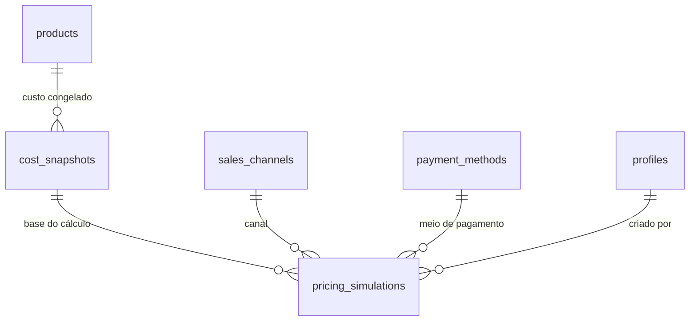

# Spec 070 — Motor de precificação (Etapa 6)

**Status:** Em andamento — motor, simulações e UI implementados no código; migrations aplicadas
**Fonte de verdade:** `task.md`, seções "Regras fundamentais de precificação" e "Motor financeiro"

## Objetivo

Calcular automaticamente o custo completo e o preço recomendado por canal e
modalidade de venda, a partir dos cadastros da Etapa 5 e dos parâmetros da
Etapa 4. O motor vive em `src/services/calculations/`, é independente da
interface e coberto por testes unitários.

## Fórmula-base

\[
P = \frac{C + F}{1 - (T + M)}
\]

- `C` = custo completo (materiais, mão de obra, despesas rateadas, perdas).
- `F` = taxas fixas (valores fixos de canal/pagamento).
- `T` = percentuais variáveis (impostos, comissões, taxas percentuais).
- `M` = margem desejada.

Validar o denominador antes de dividir: `≤ 0` ou nulo é erro explícito,
nunca NaN/Infinity. Dinheiro em centavos inteiros; percentuais em
micro-percentual (inteiro escalado).

## Sub-etapas

| Sub-etapa | Entrega | Tabelas / arquivos |
|---|---|---|
| 6.1 | Motor de cálculo base (fórmula, taxas, impostos) | `services/calculations/pricing.ts` |
| 6.2 | Custo de material por modalidade | extensão de `productCost.ts` |
| 6.3 | Rateio de despesas operacionais e mão de obra | `services/calculations/overhead.ts` |
| 6.4 | Custo completo por produto (fabricado, revenda, 3D, kit) | `services/calculations/productCost.ts` |
| 6.5 | Precificação por canal e modalidade (varejo/atacado) | `services/calculations/channelPricing.ts` |
| 6.6 | Simulações e comparação de canais | `pricing_simulations` (a definir) |
| 6.7 | UI de precificação e snapshots | `/precificacao` |

## Regras

- Nenhuma fórmula em componente, página ou Server Action.
- Regras fiscais configuráveis; nunca assumir alíquota universal.
- Preço calculado individualmente por canal e modalidade (varejo/atacado).
- Snapshots de custos, taxas e configurações em cada simulação (imutabilidade histórica).
- Conversões de unidade (5.4) aplicadas quando a unidade de uso difere da base.

## Testes obrigatórios

Custo de fabricação, revenda, kits, impressão 3D, rateios, impostos, taxas
fixas, taxas percentuais, varejo, atacado, descontos, margem negativa e
denominador inválido.

## Modelo de dados (a criar)

### `cost_snapshots`

- UUID, `product_id` FK products, `cost_cents` (custo completo), `material_cents`,
  `labor_cents`, `overhead_cents`, `components` jsonb (quantidades e custos por
  linha), `created_at`.
- Inserção apenas (imutável): sem update/delete pela aplicação.
- RLS: select autenticado, insert administrador.

### `pricing_simulations`

- UUID, `product_id` FK, `cost_snapshot_id` FK cost_snapshots, `channel_id` FK
  sales_channels, `payment_method_id` FK payment_methods (opcional),
  `margin_percent` numeric(9,6), `variable_percent` numeric(9,6),
  `fixed_fees_cents` bigint, `price_cents` bigint, `modality` text
  (varejo/atacado), `created_at`, `created_by` FK profiles.
- Imutável: insert only.
- RLS: select autenticado, insert administrador.

## Decisões

- Atacado difere do varejo pela margem (margem menor ou desconto explícito
  informado na simulação), nunca por alteração do custo.
- Simulações são persistidas (histórico de decisões de preço).
- Snapshots congelam custo no momento da simulação; alterar insumo não
  retroage.

## Pendências

- Criar migrations `cost_snapshots` e `pricing_simulations`.
- Implementar serviço de simulação e UI.