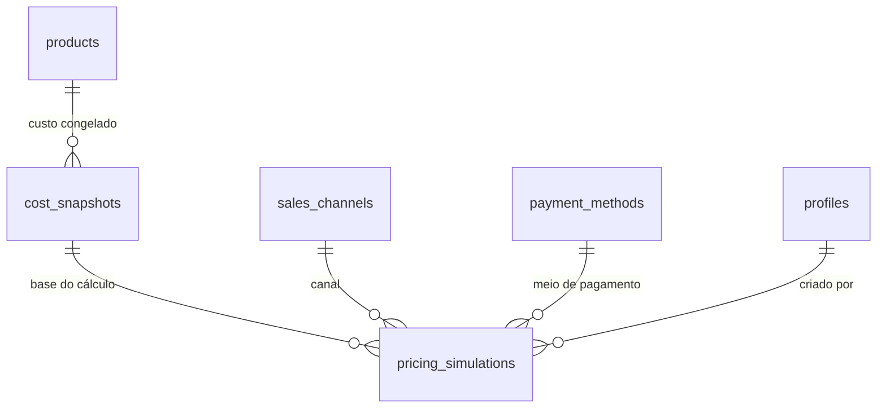

# Spec 070 — Motor de precificação (Etapa 6)

**Status:** Implementada — motor, simulações, matriz na home e impacto de insumo
**Fonte de verdade:** `task.md`, seções "Regras fundamentais de precificação" e "Motor financeiro"

## Objetivo

Calcular automaticamente o custo completo e o preço recomendado por canal e
modalidade de venda, a partir dos cadastros da Etapa 5 e dos parâmetros da
Etapa 4. O motor vive em `src/services/calculations/`, é independente da
interface e coberto por testes unitários.

## Fórmula-base

\[
P = \frac{C + F}{1 - (T + M)}
\]

- `C` = custo completo (materiais, mão de obra, despesas rateadas, perdas).
- `F` = taxas fixas (valores fixos de canal/pagamento).
- `T` = percentuais variáveis (impostos, comissões, taxas percentuais).
- `M` = margem desejada.

Validar o denominador antes de dividir: `≤ 0` ou nulo é erro explícito,
nunca NaN/Infinity. Dinheiro em centavos inteiros; percentuais em
micro-percentual (inteiro escalado).

## Sub-etapas

| Sub-etapa | Entrega | Tabelas / arquivos |
|---|---|---|
| 6.1 | Motor de cálculo base (fórmula, taxas, impostos) | `services/calculations/pricing.ts` |
| 6.2 | Custo de material por modalidade | extensão de `productCost.ts` |
| 6.3 | Rateio de despesas operacionais e mão de obra | `services/calculations/overhead.ts` |
| 6.4 | Custo completo por produto (fabricado, revenda, 3D, kit) | `services/calculations/productCost.ts` + `productCostResolver.ts` |
| 6.5 | Precificação por canal e modalidade (varejo/atacado) | `services/calculations/channelPricing.ts` |
| 6.6 | Simulações e comparação de canais | `pricing_simulations` |
| 6.7 | UI de precificação e snapshots | `/precificacao` |
| 6.8 | Matriz de preços por plataforma na home | `pricingMatrix.ts` + `PricingMatrix.tsx` |
| 6.9 | Impacto automático de mudança de insumo | `priceImpact.ts` |

## Como o custo completo é montado (2026-11-03)

`getProductCostBreakdown` (em `services/supabase/pricing.ts`) agora calcula o
custo **completo** de fabricação, e não apenas o material:

1. **Material** — soma das linhas da ficha técnica (insumos e subprodutos),
   ampliado pela taxa de falha do produto quando informada
   (`material × (1 + taxa de falha)`).
2. **Mão de obra** — `minutos da ficha × custo por minuto`, derivado da soma
   dos salários mensais ativos ÷ horas mensais padrão ativas. Entra **apenas
   quando o produto tem minutos > 0 e existe configuração de mão de obra**.
3. **Custos diretos** — energia, máquina, acabamento e depreciação de impressão
   3D, **apenas quando informados** no cadastro do produto.
4. **Overhead** — `(soma das despesas ativas ÷ volume mensal estimado)`.

Regras do overhead:

- O rateio entra **uma vez por produto final** (chamada de nível superior de
  `resolveProductCost`). Um produto usado como componente de outro (subproduto
  de kit) **não recebe o rateio de novo** — quem cobra é o produto final.
- Sem volume mensal estimado ou sem despesas ativas, o overhead é 0 e o cálculo
  continua válido (não bloqueia).
- A mão de obra é 0 quando o produto não tem minutos ou não há salário
  cadastrado — produtos **revendidos** ficam com custo de aquisição apenas.

## Regras

- Nenhuma fórmula em componente, página ou Server Action.
- Regras fiscais configuráveis; nunca assumir alíquota universal.
- Preço calculado individualmente por canal e modalidade (varejo/atacado).
- Snapshots de custos, taxas e configurações em cada simulação (imutabilidade histórica).
- Conversões de unidade (5.4) aplicadas quando a unidade de uso difere da base.

## Testes obrigatórios

Custo de fabricação, revenda, kits, impressão 3D, rateios, impostos, taxas
fixas, taxas percentuais, varejo, atacado, descontos, margem negativa e
denominador inválido.

## snapshots e simulações persistidas

### `cost_snapshots`

- UUID, `product_id` FK products, `cost_cents` (custo completo), `material_cents`,
  `labor_cents`, `overhead_cents`, `components` jsonb (quantidades e custos por
  linha), `created_at`.
- Inserção apenas (imutável): sem update/delete pela aplicação.
- RLS: select autenticado, insert administrador.

### `pricing_simulations`

- UUID, `product_id` FK, `cost_snapshot_id` FK cost_snapshots, `channel_id` FK
  sales_channels, `payment_method_id` FK payment_methods (opcional),
  `margin_percent` numeric(9,6), `variable_percent` numeric(9,6),
  `fixed_fees_cents` bigint, `price_cents` bigint, `modality` text
  (varejo/atacado), `created_at`, `created_by` FK profiles.
- Imutável: insert only.
- RLS: select autenticado, insert administrador.

## Matriz de preços por plataforma (home)

`buildPricingMatrix` (em `src/services/calculations/pricingMatrix.ts`) monta a
tabela informativa exibida na página inicial para administradores:

| Linha | Conteúdo |
|---|---|
| Produto | Nome e custo atual de fabricação |
| Por canal × modalidade | Margem usada e preço sugerido |

Regras:

- Canais considerados: todos os **canais ativos** (`sales_channels`).
- Impostos considerados: todos os **impostos ativos** (`tax_settings`).
- O meio de pagamento **não** entra na matriz base — a verificação fina com
  taxas de pagamento acontece na simulação de `/precificacao`.
- Prioridade de margem: **última simulação (produto + canal + modalidade) >
  margem padrão da empresa > contingência (30% varejo / 20% atacado)**.
- Custo de fabricação incompleto (insumo sem preço) exibe a célula sem preço e
  a etiqueta "Custo incompleto"; nunca bloqueia os outros produtos.

## Impacto automático de mudança de insumo

`analyzePriceImpact` (em `src/services/calculations/priceImpact.ts`) compara o
custo atual do produto com o custo do **último snapshot salvo**:

- Produto marcado como **"Revisar preço"** quando o custo atual difere do
  snapshot.
- Sem snapshot, não há baseline: o produto não é marcado (a primeira simulação
  criará a base).
- A página inicial atualiza ao salvar insumo (`revalidatePath("/home")`) e ao
  salvar produto. Não há evento em tempo real; a atualização acontece quando o
  painel é recarregado.

## Decisões

- Atacado difere do varejo pela margem (margem menor ou desconto explícito
  informado na simulação), nunca por alteração do custo.
- Simulações são persistidas (histórico de decisões de preço).
- Snapshots congelam custo no momento da simulação; alterar insumo não
  retroage.
- **2026-11-03:** mão de obra, despesas rateadas e custos de impressão 3D
  entram no custo de fabricação apenas quando informados — produtos revendidos
  continuam sem esses custos.
- **2026-11-03:** módulos de produção e estoque removidos; o sistema se assume
  como planilha de cálculo de preço.

## Pendências

Nenhuma pendência registrada nesta spec.