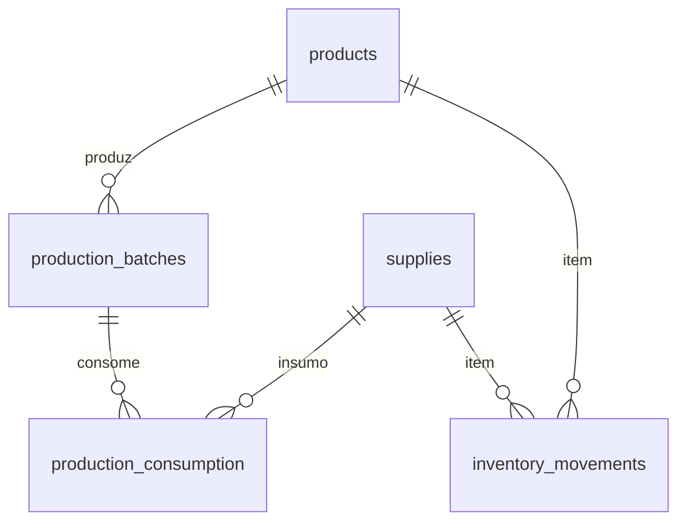

# Spec 080 — Produção e estoque (Etapa 7)

**Status:** Planejada (aguardando aprovação)
**Fonte de verdade:** `task.md`, seções "Produção" e "Estoque"

## Objetivo

Registrar a produção em lotes (consumo real de materiais, perdas, mão de obra,
energia, depreciação) e as movimentações de estoque (entradas, saídas,
consumo, perdas, ajustes), mantendo o histórico imutável.

## Sub-etapas

| Sub-etapa | Entrega | Tabelas |
|---|---|---|
| 7.1 | Lotes de produção | `production_batches` |
| 7.2 | Consumo real de materiais | `production_consumption` |
| 7.3 | Perdas e acabamento | campos em `production_batches` |
| 7.4 | Movimentações de estoque | `inventory_movements` |
| 7.5 | Saldo de estoque por insumo/produto | view ou cálculo |
| 7.6 | UI de produção e estoque | `/producao`, `/estoque` |

## Regras

- Exclusão lógica onde houver histórico.
- RLS em todas as tabelas.
- Auditoria padrão.
- Imutabilidade do histórico de movimentações.

## Modelo de dados (a criar)

### `production_batches`

- UUID, `product_id` FK products, `quantity_produced` numeric(12,3) > 0,
  `produced_at` date, `labor_minutes_actual` int, `energy_cost_cents`,
  `machine_cost_cents`, `finishing_cost_cents`, `notes`, `is_active`,
  timestamps.
- Auditoria e RLS padrão.

### `production_consumption`

- UUID, `batch_id` FK production_batches (cascade), `supply_id` FK supplies,
  `quantity_used` numeric(12,3) > 0, `unit_cost_cents` bigint (snapshot),
  created_at.
- RLS herdada via batch.

### `inventory_movements`

- UUID, `item_type` text check ('supply','product'), `item_id` uuid,
  `movement_type` text check ('entrada','saida','consumo','perda','ajuste'),
  `quantity` numeric(12,3) (positiva para entrada, negativa para saída),
  `unit_cost_cents` bigint, `reference_type` text, `reference_id` uuid,
  `notes`, `created_at`.
- Imutável: insert only. RLS select/insert administrador.

## Escopo de estoque

Insumos e produtos acabados (movimentações para ambos).