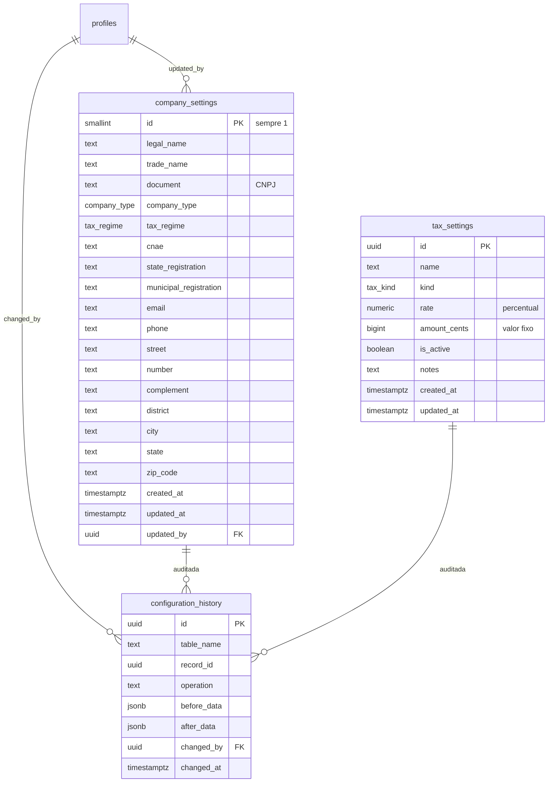
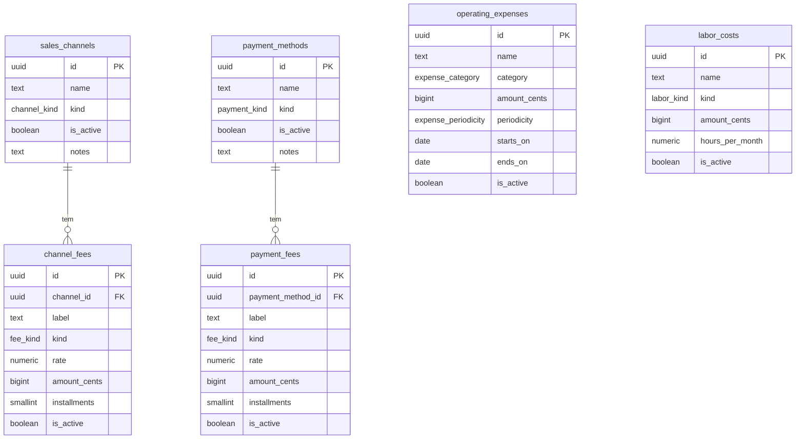

# Etapa 4 — Configurações empresariais

**Data de Criação:** 2026-11-01 19:00
**Agente:** OpenCode — DeepSeek V4.1 Flash Free
**Status:** Em andamento — 4.1 e 4.2 concluídas
**Etapa:** 4 de 9 (ver `task.md`)

## Progresso

| Sub-etapa | Situação | Commits |
|---|---|---|
| 4.1 Empresa, impostos e histórico | ✅ Concluída | `36e6cbc` |
| 4.2 Canais de venda e taxas | ✅ Concluída | `556d2de` |
| 4.3 Meios de pagamento e taxas | Pendente | — |
| 4.4 Despesas fixas e mão de obra | Pendente | — |

## Decisões tomadas na execução (além do plano)

1. **Aba Canais na página de detalhe.** Taxas de um canal ficam em
   `/configuracoes/canais/[id]`, não em modal — mantém URL compartilhável e evita
   componente de modal sem necessidade.
2. **Shell pré-renderizado vazio na rota `[id]`.** O build marca
   `/configuracoes/canais/[id]` como PPR, mas o HTML estático tem 0 bytes; nada de
   usuário vai para o estático. `instant = false` segue aplicado (validação de
   navegação desligada para rota de sessão).
3. **`CHANNEL_KINDS` mora em `features/channels`, não em `settings`.** A importação
   errada foi pega pelo teste de validação — regra de negócio testada antes da tela
   funcionando como rede de proteção.
4. **Nenhum DELETE na interface.** Canal, taxa e imposto só ativam/desativam.

## Objetivo

Registrar os parâmetros que alimentam o motor de precificação: dados da empresa,
tributação, canais de venda, meios de pagamento, despesas fixas e mão de obra.

Nada aqui calcula preço. Esta etapa apenas **guarda e audita** os parâmetros que a
Etapa 6 vai consumir.

## Escopo por sub-etapa

| Sub-etapa | Entrega | Tabelas |
|---|---|---|
| 4.1 | Empresa e impostos | `company_settings`, `tax_settings`, `configuration_history` |
| 4.2 | Canais de venda e taxas | `sales_channels`, `channel_fees` |
| 4.3 | Meios de pagamento e taxas | `payment_methods`, `payment_fees` |
| 4.4 | Despesas fixas e mão de obra | `operating_expenses`, `labor_costs` |
| 4.5 | Painel de configurações e navegação | — |

Cada sub-etapa tem migration própria, tela própria, testes e commit. Não criamos as
quatro famílias de tabela de uma vez.

## Modelo entidade-relacionamento (4.1)

## Modelo completo previsto (4.1 a 4.4)

## Tipos enumerados

| Tipo | Valores |
|---|---|
| `company_type` | `mei`, `me`, `eireli`, `ltda`, `outro` |
| `tax_regime` | `mei`, `simples_nacional`, `lucro_presumido`, `lucro_real`, `outro` |
| `tax_kind` / `fee_kind` | `percentual`, `fixo` |
| `channel_kind` | `marketplace`, `site_proprio`, `loja_fisica`, `whatsapp`, `outro` |
| `payment_kind` | `pix`, `debito`, `credito_vista`, `credito_parcelado`, `boleto`, `dinheiro`, `outro` |
| `expense_category` | `aluguel`, `energia`, `internet`, `marketing`, `manutencao`, `software`, `outro` |
| `expense_periodicity` | `mensal`, `anual`, `por_producao` |
| `labor_kind` | `mensal`, `por_hora`, `por_peca` |

## Decisões técnicas

1. **Dinheiro em centavos inteiros (`bigint`).** Nunca `float`. A conversão para
   exibição acontece em `lib/money.ts`, com teste.
2. **Percentual em `numeric(9,6)`.** Postgres devolve string; o motor trabalha com
   inteiro escalado (micro-percentual). Sem arredondamento de ponto flutuante.
3. **Empresa é linha única.** `id smallint primary key check (id = 1)`. Garante que
   nunca existam duas configurações concorrentes e simplifica o carregamento.
4. **Imposto percentual e fixo não compartilham coluna.** `check` obriga exatamente
   uma das duas colunas conforme `kind`, impedindo registro ambíguo.
5. **Histórico por gatilho.** `configuration_history` recebe `before_data` e
   `after_data` em `jsonb` a cada `insert`/`update`/`delete` nas tabelas de
   configuração. O usuário vem de `auth.uid()`. Auditoria não depende da interface.
6. **Exclusão lógica** nas tabelas que alimentam cálculo: `is_active` desliga o
   registro sem apagar o histórico. `tax_settings` e taxas usam o mesmo padrão.
7. **Dinheiro e percentual validados no banco.** `check (amount_cents >= 0)`,
   `check (rate >= 0 and rate <= 100)`, `check (installments >= 1)`.
8. **RLS.** Leitura para qualquer usuário autenticado (operador precisa ver os
   parâmetros); escrita apenas para administrador, via `is_admin()`. Escrita sempre
   por Server Action, que também valida no servidor.
9. **Sem snapshot nesta etapa.** O snapshot de configuração entra no cálculo
   (Etapa 6), junto com `cost_snapshots`. Aqui só guardamos o estado atual e o
   histórico de alterações.

## RLS prevista

| Tabela | SELECT | INSERT/UPDATE/DELETE |
|---|---|---|
| `company_settings` | autenticado | administrador |
| `tax_settings` | autenticado | administrador |
| `configuration_history` | administrador | nenhum (só gatilho) |
| `sales_channels`, `channel_fees` | autenticado | administrador |
| `payment_methods`, `payment_fees` | autenticado | administrador |
| `operating_expenses`, `labor_costs` | autenticado | administrador |

`configuration_history` sem política de escrita: o gatilho roda como `security definer`
e nenhuma sessão pode forjar auditoria.

## Validações com teste unitário

`src/lib/validations/settings.ts`:

- CNPJ: 14 dígitos, dígitos verificadores corretos, aceita máscara.
- Percentual: 0 a 100, no máximo 6 casas decimais.
- Dinheiro: texto em reais convertido para centavos sem erro de arredondamento
  (`"1.234,56"` → `123456`).
- Parcelas: inteiro de 1 a 24.
- Nome obrigatório, mínimo 4 caracteres.
- UF: duas letras maiúsculas.
- CEP: 8 dígitos.

## Telas

`/configuracoes` (administrador escreve, operador só lê):

1. **Empresa** — formulário único com dados cadastrais e fiscais.
2. **Impostos** — lista com inclusão, edição e desativação.
3. **Canais** e **meios de pagamento** — lista com taxas por linha.
4. **Despesas** e **mão de obra** — lista com vigência.

A navegação passa a marcar `Configurações` como disponível apenas para administrador.

## Testes

| Arquivo | Cobertura |
|---|---|
| `src/lib/money.test.ts` | reais ↔ centavos, entrada inválida |
| `src/lib/percent.test.ts` | percentual ↔ micro-percentual, faixa |
| `src/lib/validations/settings.test.ts` | CNPJ, CEP, UF, parcelas, nome |
| `src/lib/validations/fee.test.ts` | regra de taxa percentual e fixa |

## Riscos

- **Modelo de taxas:** um canal pode ter várias taxas (comissão + frete + adicional).
  Por isso a taxa é tabela filha, não coluna do canal.
- **Parcelamento:** `installments` nulo significa "qualquer quantidade"; valores
  específicos permitem taxa diferente por faixa. O motor resolve a faixa na Etapa 6.
- **Histórico:** `jsonb` cresce; sem índice além de `(table_name, record_id)`.
  Aceitável nesta escala.

## Critérios de aceite da Etapa 4

| Critério | Como verificar |
|---|---|
| Migration aplicada com RLS em todas as tabelas | consulta em `pg_policies` |
| Operador não escreve | tentativa de `insert` com sessão de operador |
| Histórico registra alteração | editar empresa e conferir `configuration_history` |
| Valores inválidos rejeitados | testes unitários e `check` do banco |
| Nenhum link para tela inexistente | menu e `navigation.test.ts` |
| `typecheck`, `lint`, testes e `build` | `./pre-push.sh` |
