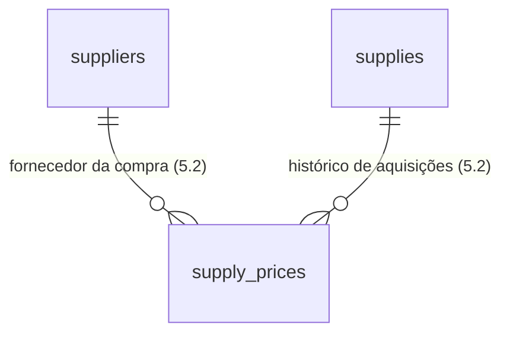

# Etapa 5 — Cadastros (insumos, fornecedores, produtos)

**Data de Criação:** 2026-11-02 10:00
**Agente:** OpenCode — GLM-5.3-Flash Free
**Status:** ✅ Etapa 5 concluída no código (5.1 a 5.4); migrations pendentes de aplicação no Supabase
**Etapa:** 5 de 9 (ver `task.md`)

## Objetivo

Cadastrar o acervo material do ateliê: quem fornece, o que é comprado (com
histórico de preços de aquisição) e os produtos com suas composições. Nada aqui
calcula preço — a Etapa 6 consome estes cadastros.

## Progresso

| Sub-etapa | Situação | Commit |
|---|---|---|
| 5.1 Fornecedores | ✅ Concluída | ver commit |
| 5.2 Insumos e aquisições | ✅ Concluída | ver commit |
| 5.3 Produtos e composições | ✅ Concluída | ver tarefa 5.3 |
| 5.4 Conversões de unidades | ✅ Concluída (código) | ver tarefa 5.4 |

## Decisões tomadas na execução (além do plano)

1. **Fornecedores antes de insumos.** A compra do insumo referencia o fornecedor;
   a migração do insumo já nasce com a FK pronta.
2. **Documento único quando preenchido.** `suppliers_document_key` parcial —
   impede o mesmo CPF/CNPJ em dois fornecedores, mas permite fornecedores
   informais sem documento (compra avulsa).
3. **Contato mínimo.** Nome, documento, telefone, e-mail, observação. Sem
   endereço nesta versão — cadastros avulsos são comuns no artesanato.
4. **Cadastro restrito ao administrador.** Mesmo padrão das configurações:
   menu, página e Server Actions checam papel; o operador visualiza apenas o
   que a etapa operacional permitir mais tarde.

## Modelo entidade-relacionamento (5.1)

## Regras de integridade da 5.1

- Nome 2–120 caracteres, único (case-insensitive, `lower(btrim(name))`).
- Documento: 11 ou 14 dígitos, com dígitos verificadores validados na aplicação
  e unicidade garantida no banco (índice parcial `where document is not null`).
- Telefone: 10 ou 11 dígitos. Exclusão lógica (`is_active`); RLS habilitada;
  auditoria em `configuration_history`.

## Escopo por sub-etapa (5.2)

`supplies`: nome (único), categoria (`materia_prima`, `revenda`, `impressao_3d`,
`embalagem`, `outro`), unidade de medida (enum), observação, situação.

`supply_prices`: por compra — data, fornecedor (opcional), quantidade comprada,
valor pago, frete; custo por unidade gravado como snapshot no momento da
gravação. O "preço atual" do insumo é a compra mais recente.

## Verificação no banco (executada)

- Documento duplicado rejeitado (23505) e documento de 3 dígitos rejeitado
  (23514), com limpeza dos registro de teste em seguida.
- Policies e triggers criados; RLS habilitada.

## Pendências

- Aplicação das migrations da Etapa 5 no Supabase (ação manual).
